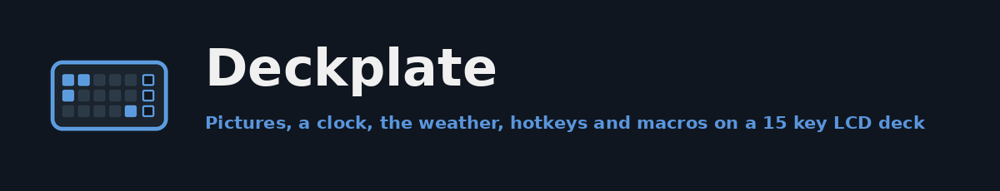
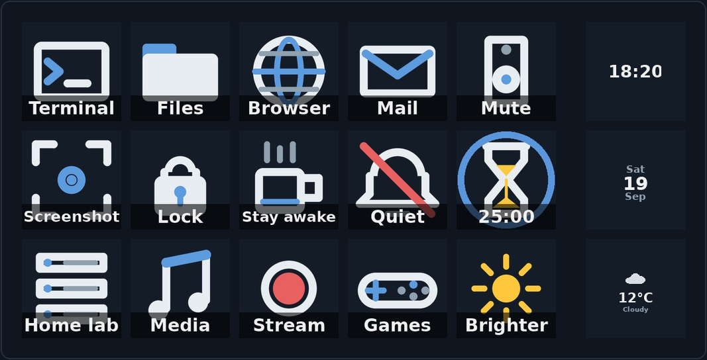
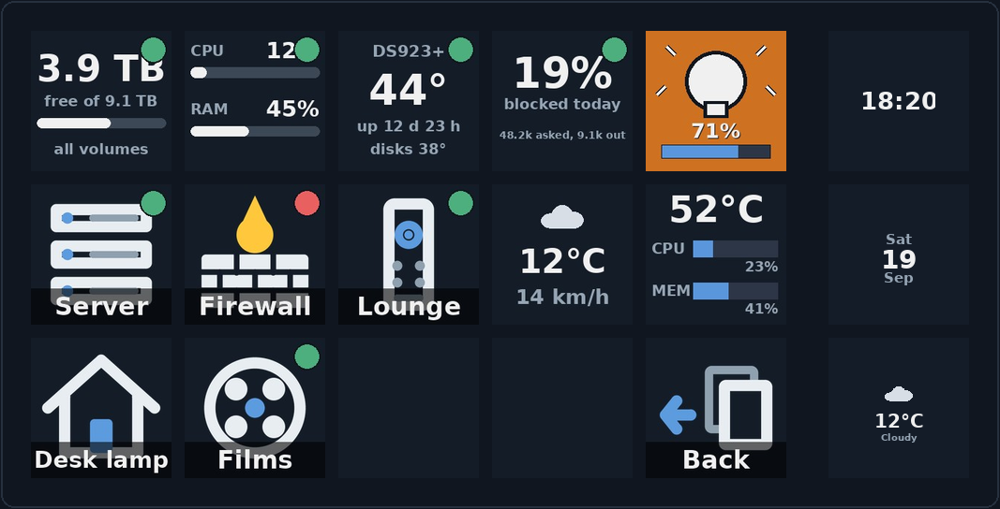
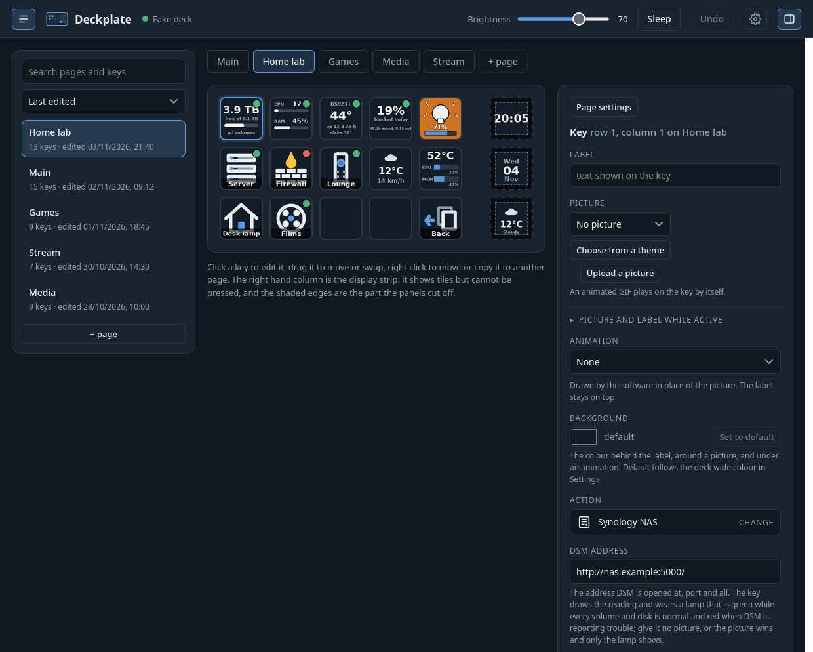
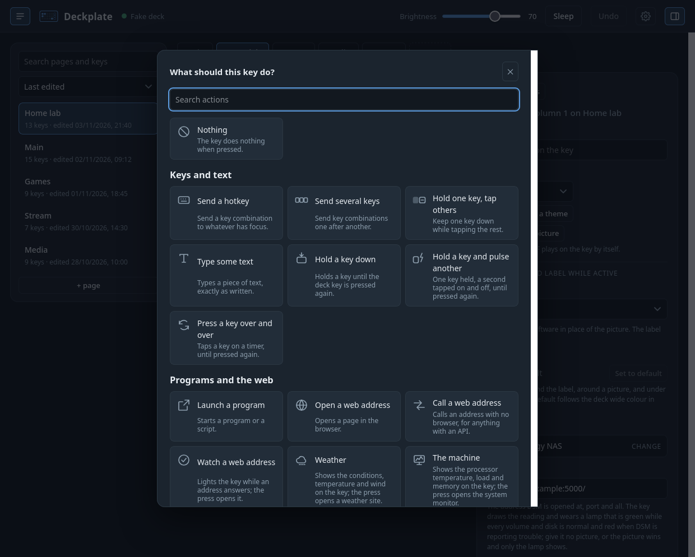
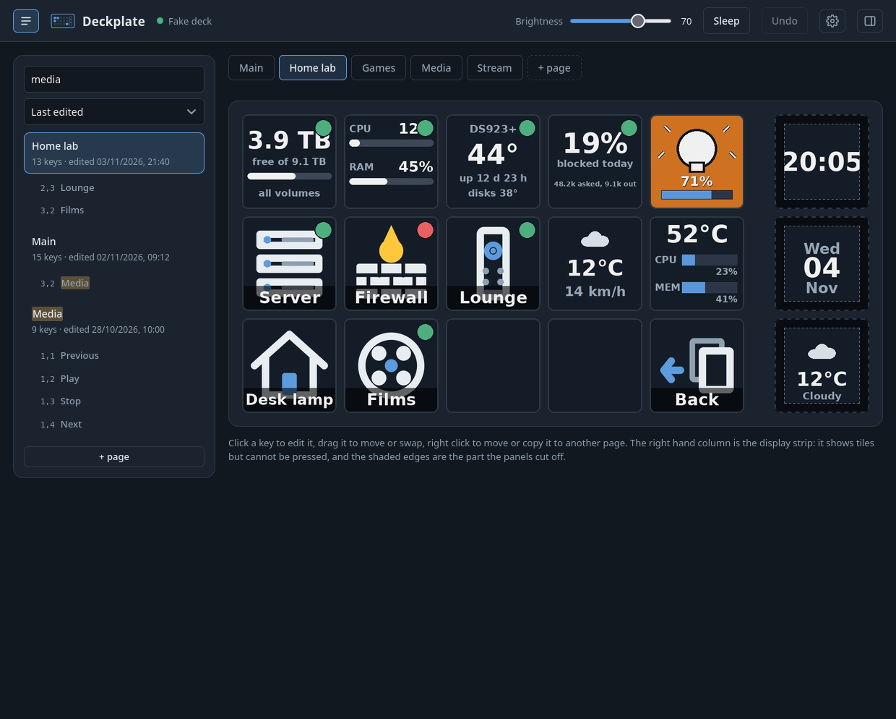
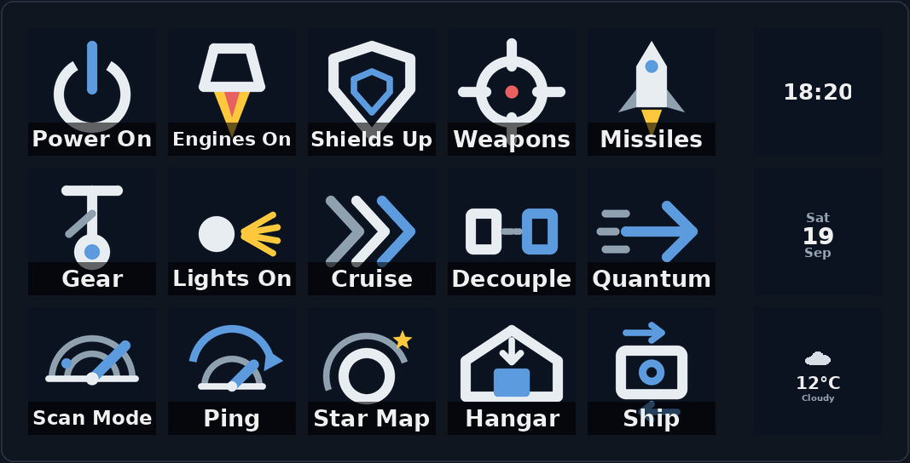
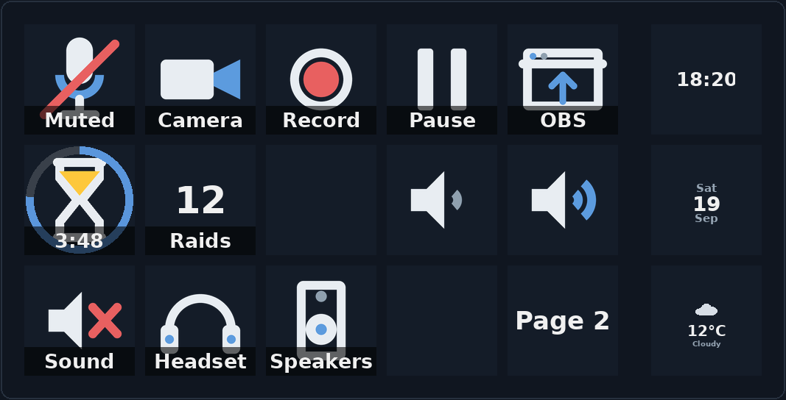

# Deckplate

A driver and controller for the SOOMFON Stream Controller, a 15 key LCD macro
deck that is a Mirabox Stream Dock 293S underneath. It replaces the official
Windows only software with one program that runs on Linux and Windows: a
daemon that drives the deck from a TOML file, and a configuration page, served
by the daemon, that edits everything live.



Every picture of a deck in this file is drawn by the software itself from a
configuration file, with no deck plugged in. The pictures of the configuration
page are screenshots of the page running over the same in memory stand in,
which is why its header says "Fake deck". Nothing here is a mock up.

## What a key can do

A key has a picture, a label, or both, and an action for its press. It may
also carry a second action for a long press and a third for a double press, a
picture and label to wear while its thing is on, a built in animation (pulse,
spinner, wave, rainbow, scroll, a shimmer rolling down the picture itself,
or an animated GIF), its own background
colour, and a page may lay one wallpaper across all fifteen keys.

| Action | What it does |
| --- | --- |
| `hotkey` | sends a key combination, `ctrl+alt+t`, `shift+f5`, `media_play_pause`; left and right modifiers can be told apart |
| `sequence` | several combinations in order, with a pause between them |
| `chord` | holds one key while tapping others, with a random pause before each tap |
| `hold` | keeps a key pressed until the deck key is pressed again, letting go for a moment now and then so it does not look taped down |
| `boost` | holds one key while a second goes on and off, with optional random phase lengths, a build up and a key tapped between boosts |
| `repeat` | taps a key every so many milliseconds until pressed again |
| `text` | types a piece of text, with an optional enter and a pause between characters |
| `launch` | starts a program, with a separate command for Linux and Windows if needed |
| `url` | opens a page in the browser |
| `request` | calls a web address without a browser, any method, body and headers, the token read from a file outside the config |
| `volume`, `audio_output` | sets or steps the level, mutes, switches or cycles the output device |
| `window` | brings a program's window to the front or launches it, or minimises, maximises or closes it |
| `toggle` | alternates between two actions and shows which way it is |
| `timer`, `stopwatch`, `counter` | count down with a ring and a sound at the end, count up, or tally; the key shows the value |
| `page`, `brightness`, `sleep` | go to a page (by name, next or previous), set or step the brightness, put the deck to sleep |
| `multi` | several of the above, one after another |
| `stay_awake`, `dnd` | keep the machine from idling, or hold notifications back, until pressed again |
| `status` | watches a web address and wears a green, red or grey lamp; the press opens it |
| `weather` | draws the conditions, temperature and wind on the key; the press opens a weather site |
| `system` | draws the processor temperature, load and memory; the press opens the system monitor |
| `wled` | draws a WLED light's colour and brightness; the press toggles it, turns it on or off, picks a preset or steps the brightness |
| `pihole` | draws today's share blocked on a Pi-hole 6 with a lamp for the blocking state; the press pauses and resumes it |
| `homeassistant` | draws one Home Assistant entity's state, a light, a sensor, a door, with a lamp while it is on or off; the press toggles it, turns it on or off, or calls a service |
| `synology` | draws a Synology NAS over DSM's API: free space with a gauge, the processor and memory loads, or the model, temperature and uptime, with a lamp for its health; the press opens DSM |
| `kodi` | a remote control action for Kodi over its JSON RPC, play, pause, next, up, select and the rest, on the Kodi in `[kodi]` or on a second player the key names |

Two things any key can wear, whatever its action: a `lamp` watching an
address of its own, green while it answers (or, for a WLED device, while the
lights are on; or, with `kind = "page"`, the sum of the lamps on another
page, green while every one is green, red while every one is red, amber in
between, with `keys` choosing which positions count), and `playing`, which puts the cover or poster of what a
player is playing over the whole key while it plays, the player being this
machine's own or a Kodi, with the title on a band or scrolling along the
bottom.



The display strip on the right shows a clock, the date, the weather, what is
playing (with its cover art), the machine's load, a picture or an animation,
one per panel. With `follow_focus` on, a page that names a `match_window`
comes up by itself when a matching window is in front, so a browser page or
a game page appears when that program does. At night the deck dims to
`night_brightness` between sunset and sunrise, worked out from the weather
coordinates.

## The configuration page



The deck in the middle is what the deck is showing at that moment, key for
key, with a flash when a real key is pressed. Click a key to edit it on the
right: label, picture, the action and its fields, the active face, the lamp
and the playing picture. The action is chosen from a window of tiles, each
with a drawing and a line saying what it does, grouped and searchable:



Keys for the hotkey, sequence, chord and hold actions are captured rather
than typed: click Capture and press them. Drag a key to move it, drop it on
another to swap them, and right click it to move or copy it to another page.
Pictures come from an upload or from the thirteen shipped icon themes behind
"Choose from a theme". Every change saves a moment after you make it and the
deck updates at once; Undo steps back.

The editor sits under the deck across the whole width, the deck drawn
smaller to leave it in view, and comes and goes from the button at the end
of the header. The pages list on the left is where a page is picked, open
by default and scrolling inside the deck's height; its button is at the
start of the header. Editor position in the settings puts the editor
beside the deck instead, with page tabs above the deck, remembered by that
browser. Neither pane moves by itself. The list shows every page with its key count and
when it was last edited, sorted by deck order, name, last edited or last
shown, and a search finds pages by name and keys by label, action or the
page they lead to; a key in the results takes the deck to its page and
selects it.



The cog opens the settings window for what applies to the whole deck:
brightness at start, idle sleep, the deck wide background, the strip panels'
visible area, the pictures folder with what uses each picture, the tray
icon, and where the API listens. Passwords for Kodi, Pi-hole and a Synology
NAS are typed once on the page and written to a file under
`~/.deckplate-tokens` with owner only permissions; the config holds only the
path, and the password never appears in it, in the page again or in the log.

The page is plain HTML, one stylesheet and one script with no build step. It
opens in its own window through pywebview (WebKitGTK on Linux, WebView2 on
Windows), or in the normal browser at `http://127.0.0.1:8765/` with
`gui --browser`.

## Running it

Python 3.11 or newer. On Linux the environment needs the system packages for
the window, which pip cannot install:

```bash
sudo apt install python3-gi python3-gi-cairo gir1.2-gtk-3.0 gir1.2-webkit2-4.1 gir1.2-ayatanaappindicator3-0.1
python3 -m venv --system-site-packages .venv
.venv/bin/pip install -r requirements-dev.txt
.venv/bin/python -m pytest
sudo ./deploy/install-udev.sh
```

The udev rule makes the deck's hidraw node readable; unplug and replug it
once. On Windows use `.venv\Scripts\python.exe`, no udev step, and close the
official SOOMFON app first or it swallows every report from the deck. `run`
looks for the official app, OpenDeck and StreamController at start and asks
whether to stop them.

```bash
.venv/bin/python -m deckplate run
.venv/bin/python -m deckplate gui
```

The first run writes a default config, `~/.config/deckplate/config.toml` on
Linux and `%APPDATA%\deckplate\config.toml` on Windows, and tells you where.
Edit it by hand or from the page; the daemon notices the save and applies it
live. Pictures go in the `images` folder next to it. While the daemon runs it
puts an icon in the system tray, with Open for the configuration window and
Quit; `[tray]` in the config or the tick in Settings turns it off. If the
deck is unplugged the daemon waits and reconnects.

For a clickable Deckplate on the desktop and in the menu, run
`deploy/install-desktop.sh` (or `deploy\install-desktop.ps1` on Windows) from
an unzipped release: it installs the single file program under your home,
with one click starting the daemon if it is not running and opening the
window. The daemon logs to `~/.local/state/deckplate/run.log` on Linux and
`%LOCALAPPDATA%\deckplate\run.log` on Windows.

## The config file

The file is documented by its own comments, and `examples/` holds six
complete setups drawn below. In short:

```toml
[deck]
brightness = 70
background = "#141c28"
theme = "wrist-console"   # the clock, date, weather and gauges drawn in this theme's look

[strip]
tiles = ["clock", "date", "weather"]

[[pages]]
name = "Main"

[[pages.keys]]
row = 0
column = 0
label = "Terminal"
image = "theme:desktop/terminal"
action = { type = "launch", command = "x-terminal-emulator" }

[[pages.keys]]
row = 0
column = 1
image = "theme:controls/mic"
image_active = "theme:controls/mic-off"
action = { type = "toggle", on = { type = "hotkey", keys = "ctrl+shift+m" }, off = { type = "hotkey", keys = "ctrl+shift+m" } }

[[pages.keys]]
row = 0
column = 2
action = { type = "synology", url = "http://nas.example:5000/", account = "deck", token_file = "~/.deckplate-tokens/synology" }
```

`[weather]` holds the coordinates and units (`deckplate geocode "Town"`
finds them), `[kodi]` where Kodi answers, `[server]` where the API listens,
and `[tray]` whether the icon shows.

### Example setups

Copy one over your config, or open it beside your own and take the keys you
want. They use the shipped icons only.

- `examples/space-sim.toml`: a cockpit, the ship's systems as toggles, a
  quantum key held until the jump takes, and a second page for out of the
  seat with the run timed and counted.
- `examples/stream-desk.toml`: microphone and camera toggles with their own
  faces, the recording controls, a break timer, a counter, the volume and
  the output, and a page of scene hotkeys.
- `examples/meetings.toml`: mute and camera, the output, the windows a call
  needs, a stopwatch for how long it has run, and two sentences typed.
- `examples/focus-timer.toml`: timers, a stopwatch, a counter and the
  brightness on one page.
- `examples/home.toml`: lights and a socket through a home automation box,
  a music player over its web API, and the token kept out of the config.
- `examples/linux-desktop.toml`: the desktop itself, with a second page to
  lock, sleep, log out, restart and shut down behind long presses.





The pictures are drawn from the files by `tools/render_layout.py`, which
opens no device.

### Icon themes

Thirteen themes ship with the app, every icon drawn in code by
`tools/make_icons.py` and free to ship: Controls (the actions above, four of
them animated), Desktop (the everyday desktop and the home lab), Sherbet and
Lagoon (the same two sets in warm and cool colour sweeps), Space Game, six
game flavoured sets that borrow a mood and no name or emblem (Grimdark,
Wayfarer, Field Command, Rift, Deep Colony, Neon Chrome), and two consoles
with a lit twin of every icon for toggles: Amber Console, pixel art on an
old amber terminal, and Wrist Console, the everyday icons, the space sim
glyphs and a survival set (dose meter, radiation, health, canteen, hatch, gas mask,
compass, the words STATUS, ITEMS, DATA, MAP and RADIO) drawn smooth in green
phosphor on a dark tube with scan lines and a glow, as a wrist worn
computer from a retro future would show them. The whole set is on one sheet in
[docs/images/themes.png](docs/images/themes.png).

A theme can lend its look to the tiles the daemon draws itself, the clock,
the date, the weather, the machine, the lights, the Pi-hole and the NAS,
which cannot be pictures because they are drawn from a reading. Wrist
Console does: set `theme = "wrist-console"` under `[deck]`, or on one page
to override the deck, and those tiles come out in the same green phosphor,
with the same glow, corner fall and scan lines, drawn at three times the
size and shrunk exactly as the icons were. On the page it is the Look
choice in the deck settings and in each page's own settings. A theme
declares its look as a `look` block in its manifest, so another theme can
carry one too.

## The local API

While `run` is going it serves a small API on `http://127.0.0.1:8765/`, the
channel the page uses and handy on its own: `GET /api/state`, the tiles as
pictures at `/api/tiles/ROW/COL.jpg`, the config as TOML or as JSON, the
pictures folder, server sent events for presses and page changes, and
`POST /api/page`, `/api/brightness`, `/api/press`, `/api/wake` and
`/api/sleep`. POST bodies must be JSON and the config PUT must be TOML, and
the `Origin` and `Host` headers are checked, so a website open in your
browser cannot drive the deck. `[server]` sets the bind address and port; off
this machine a token is required on every request. The module comment at the
top of `deckplate/server.py` lists every route.

## Commands

| Command | What it does |
| --- | --- |
| `run` | drive the deck from the config file; `--config PATH` for another file |
| `gui` | open the configuration page in a window; `--browser` for the normal browser |
| `config-path`, `init-config` | where the config lives; write the default one |
| `geocode "Town"` | coordinates for `[weather]` |
| `devices`, `probe`, `listen 60` | list decks, show numbered tiles and print presses, print presses for a minute |
| `show ROW COL FILE`, `brightness 60`, `clear` | one picture on one key, the brightness, blank every key |
| `calibrate-strip`, `calibrate-grid` | measure the strip panels' visible area and the gaps between keys |

## Layout of the code

| Path | Purpose |
| --- | --- |
| `deckplate/protocol.py`, `device.py`, `layout.py`, `images.py` | the wire format, the hidapi transport and the `Deck` class, positions to key numbers, pictures to the panels' JPEG |
| `deckplate/config.py` | the TOML file, validated into dataclasses |
| `deckplate/controller.py` | the daemon loop: render, presses, idle sleep, live reload |
| `deckplate/actions.py`, `presses.py`, `holds.py`, `hotkeys.py` | what a press does, press or hold or double, the held keys, key names and the X test, pynput and xdotool backends |
| `deckplate/tiles.py`, `animations.py`, `themes.py`, `live.py` | every picture a panel shows |
| `deckplate/weather.py`, `status.py`, `lights.py`, `pihole.py`, `synology.py`, `homeassistant.py`, `kodi.py`, `media.py`, `system.py` | the things the deck watches, each polled on a thread of its own |
| `deckplate/focus.py`, `awake.py`, `desktop.py`, `audio.py`, `conflicts.py` | the desktop: the focused window, idle and notifications, windows and sound, other deck software |
| `deckplate/server.py`, `web/`, `gui.py`, `tray.py`, `cli.py` | the API, the page, its window, the tray icon, the command line |
| `examples/`, `deploy/`, `tools/` | example setups, the udev rule and installers, the icon, theme and picture tools and the build |
| `tests/` | pytest suite, no hardware needed |

## Building the single file program

```bash
.venv/bin/python tools/build.py
```

PyInstaller builds `deckplate` (or `deckplate.exe` on Windows, each platform
building its own) after running the tests, stages it with the installers,
and writes a zip. The Linux program is about 30 MB, the Windows one about
23 MB and needs nothing beyond Windows 11's own WebView2 runtime.

## Safety rule for the deck

Read `docs/hardware-safety.md` before touching a deck. The daemon only ever
sends seven commands: init, keep alive, brightness, clear, key image, commit
and sleep. The deck understands others, including a whole screen picture and
a mode change, and on 10 September 2026 an experiment with those left a deck
unable to start its USB interface. Two gates enforce the rule: the protocol
module refuses to build any other command unless the caller passes
`experimental=True`, and the device layer inspects every packet before it is
written and refuses any other command unless the deck was opened with
`allow_experimental=True`. The daemon never sets either. `REVIEW.md` has the
protocol and the hardware findings; the protocol was worked out by the
community around the mirajazz library and the OpenDeck akp153 plugin, and
confirmed here on real hardware.

## Licence

[GPL-2.0-or-later](https://www.gnu.org/licenses/gpl-2.0.html)
